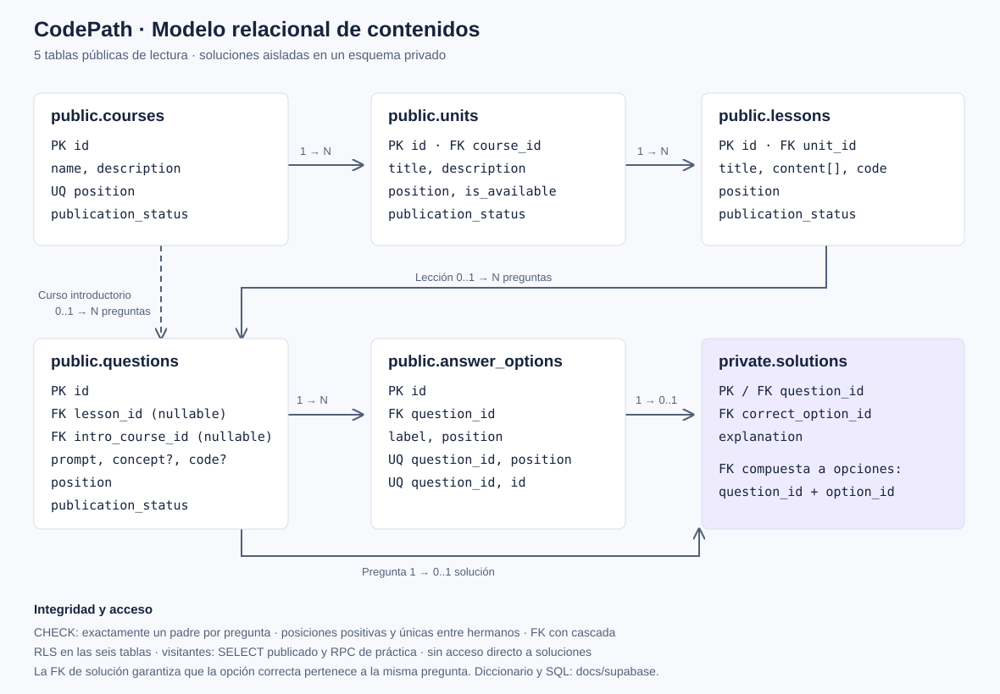
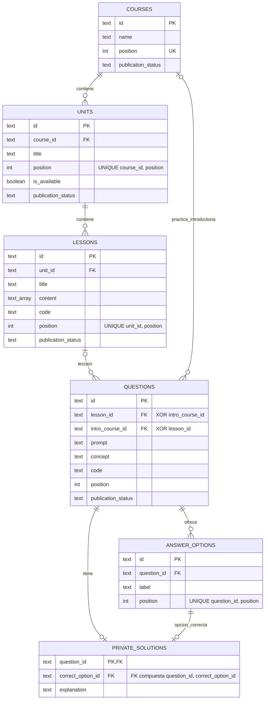

# Modelo entidad-relación

Versión editable en Mermaid:

Una pregunta pertenece **exclusivamente** a una lección o a la práctica introductoria de un curso. No pertenece a ambos. Una lección tiene una unidad y una unidad tiene un curso. No se almacena `course_id` en las lecciones ni en sus preguntas.

Una pregunta tiene cero o una solución mientras se edita como borrador, y debe tener una solución antes de publicarse. El control administrativo `verify.sql` comprueba esa completitud, además del mínimo de preguntas/opciones. El `CHECK`, las FK y los índices únicos son restricciones obligatorias del servidor; la completitud editorial se revisa antes de publicar.

Las FK usan `ON DELETE CASCADE`: eliminar un curso desde administración elimina su contenido dependiente. Los visitantes carecen de permisos de borrado. Para retirar contenido sin perderlo se usa `publication_status = 'archived'`.

`position` se exige positivo y único entre hermanos. La aplicación siempre consulta con `ORDER BY position`, incluso si los registros se insertaron o editaron en otra secuencia. El array de párrafos conserva el orden interno de lectura y no contiene entidades relacionadas ni soluciones.
